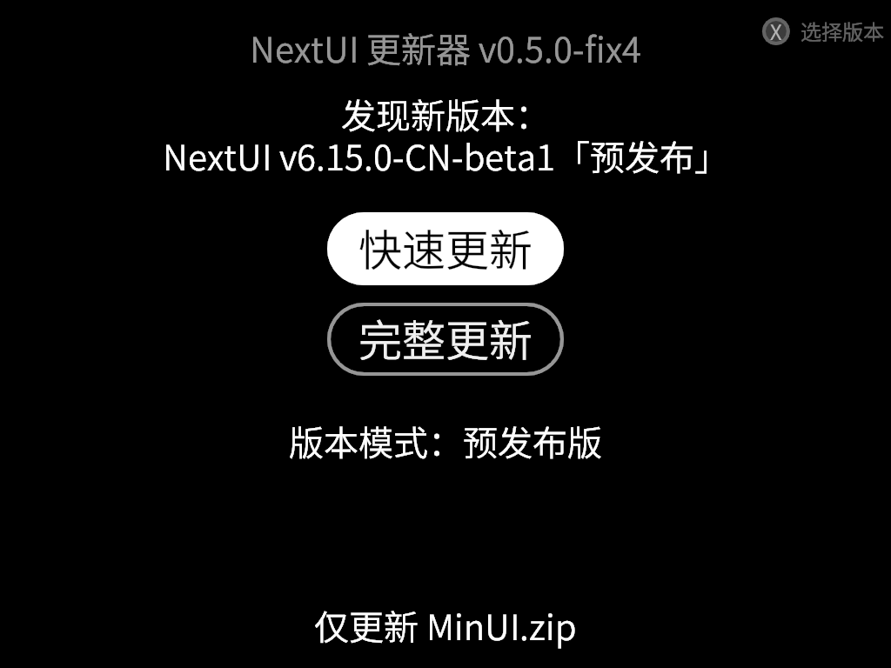

# NextUI OTA Updater PAK

用于在设备端（OTA）更新 NextUI 的 PAK。已在 TrimUI Brick 上测试（Smart Pro 也可能可用）。需要 Wi‑Fi（显然）。

## 安装

将 `nextui-updater-pak.zip` 解压到 SD 卡根目录（合并/覆盖同名文件即可）。

## 操作说明

- **方向键 上/下**：在按钮之间移动
- **A 键**：确认/选择
- **B 键**：返回/退出
- **X 键**：版本选择

## 版本模式

主界面最下方的「版本模式」按钮可以在两种模式之间切换（默认稳定版）：

- **稳定版**：只检查/列出正式发布的版本，跳过 GitHub 上标记为预发布（prerelease）的版本。
- **预发布版**：同时列出预发布（测试）版本，版本号后会标注「预发布」，并默认选中最新发布的版本。

设置保存在 SD 卡 `.userdata/shared/nextui-updater.txt`（`version_mode=stable` 或 `version_mode=prerelease`），重启后仍然生效。

稳定版（左）与预发布版（右，版本号后标注「预发布」）：




## 自更新

更新器会检查本仓库 `PandaQuQ/nextui-updater-pak-CN` 的新版本（不再检查英文原版 `LanderN/nextui-updater-pak`），并遵守上面的「版本模式」设置。

已经安装 **fix3 及更早版本** 的用户，设备上的更新器仍会去查英文原版仓库，不会自动切过来。需要先手动安装一次本仓库发布的新版本（将 `nextui-updater-pak.zip` 解压到 SD 卡根目录），之后即可正常自更新。

请通过仓库的 `release.yml` 工作流发版，以便把版本 tag 写入程序。本地手动编译的包不带 tag，可能被当成 `0.5.0` 并再次触发更新。

## 字体

更新器使用 NextUI 系统设置里选择的字体（读取 `.userdata/shared/minuisettings.txt` 的 `font=`）：

- 内置字体：`font1.ttf` 梦源黑体（默认）、`font2.ttf` 缝合像素、`font3.ttf` 寒蝉半圆体（兼容旧的数字 id 和 `fontOrder`）
- 自定义字体：`font=custom:<文件名>`，从 SD 卡根目录 `Fonts/` 读取

字体不存在或无法加载时自动回退到默认字体；自定义字体缺少的字（如中文）会由内置字体补上。

## 在电脑上测试（开发用）

桌面构建（`cargo build`）可直接在 Linux 下运行，键盘 上/下/回车/X/Esc/左/右 对应手柄按键。两个环境变量便于测试：

- `NEXTUI_SDCARD_ROOT`：模拟的 SD 卡根目录（默认 `/mnt/SDCARD/`）
- `NEXTUI_UPDATER_API_BASE`：GitHub API 地址（默认 `https://api.github.com`），可指向本地模拟服务器

注意：更新完成后会执行 `reboot`，测试时请在 `PATH` 里放一个假的 `reboot` 脚本。

## 使用 [cross-rs](https://github.com/cross-rs/cross) 为 tg5040 构建

```bash
cross build --release --target=aarch64-unknown-linux-gnu
```

编译产物在 `target/aarch64-unknown-linux-gnu/release/nextui-updater-rs`。

## 打包发布 zip

```bash
scripts/create_pak.sh
```

生成的 zip 在 `./nextui-updater-pak.zip`。

## 许可证

本项目开源，使用 MIT License。

## 贡献

欢迎贡献！如果你有任何改进想法，欢迎提交 Pull Request。
